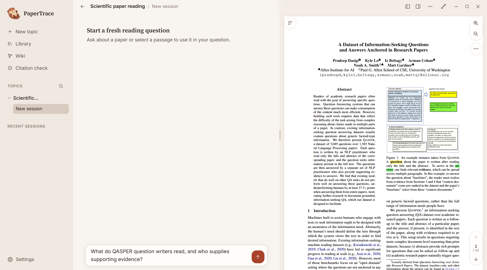
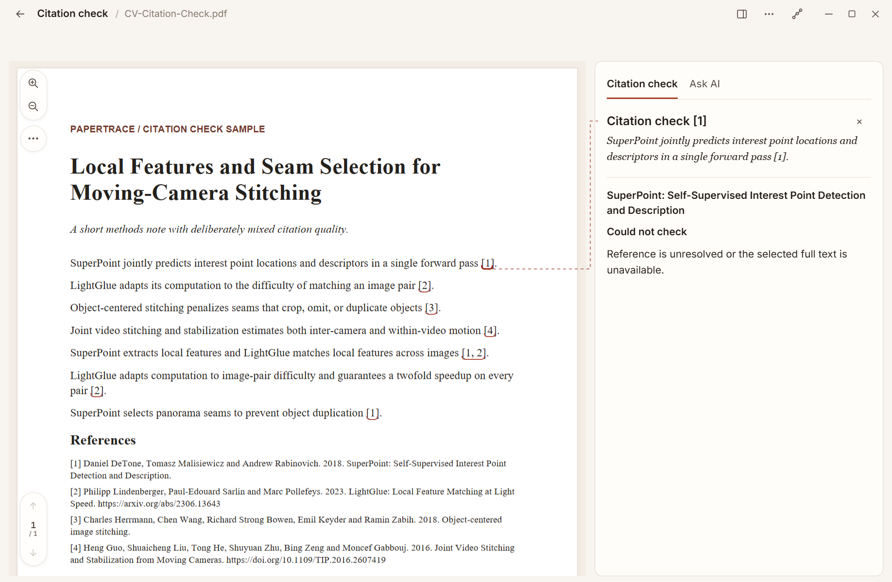
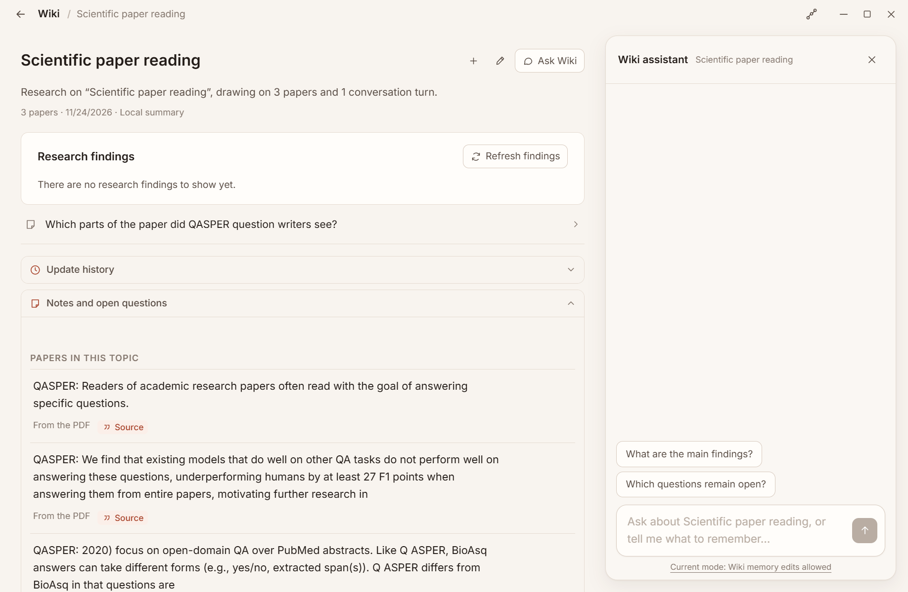

<h1 align="center">PaperTrace</h1>

<strong>What does the paper actually say?</strong>

Follow a citation in an answer back to the passage. Check a claim in your own manuscript against the paper you cited.

<a href="README.md">中文</a> · <b>English</b>　｜　<a href="docs/readme/USER_GUIDE.pdf">Illustrated user guide (PDF)</a> · <a href="backend/README.md">Desktop setup</a>

## Follow an answer to its source

Add the QASPER paper to a topic, open **Read & Ask**, and ask **“Could the people who wrote the questions see the whole paper?”**

Click the numbered citation to open page 1. The abstract distinguishes the question writers, who saw only the title and abstract, from the NLP practitioners who supplied answers and evidence. Ask a narrower follow-up in the same conversation and check its citation against the original wording. The walkthrough is on page 3 of the guide.

## Check citations in your manuscript

Add the cited papers to your topic, then import your manuscript PDF in **Citation check**. Select a citation number to see the sentence you wrote, its reference and the assessment. When the source supports only part of a claim or conflicts with it, open the passage to decide how to revise your sentence.

*In the example on page 8 of the guide, the manuscript cites SuperPoint. Its full text is missing from the topic, so the citation is marked “Could not check.” Add the cited paper and run the check again.*

## Pick up an open question next time

The topic Wiki keeps passages, research notes and open questions together. This example contains material from QASPER and SciBERT. On your next visit, ask **“Which questions still need evidence?”** or follow a note’s source back to the paper.

## Get started

1. Follow the [desktop setup instructions](backend/README.md) and test your model connection.
2. Create a topic and import a PDF with selectable text. You can also import a bibliography in BibTeX, RIS, CSL JSON or Zotero RDF format.
3. Ask a question in **Read & Ask** and open a numbered citation. Reading coverage and the agent trace show what the run actually consulted.

Papers, annotations, notes and conversations are stored locally. When using a remote model, questions and relevant excerpts are sent to the selected provider. Literature discovery contacts OpenAlex. This branch also offers local OpenCode in Settings. The built-in agent is the default.

[Frontend integration](docs/product-plan/Backend_Settings_Handoff_ZH.md) · [Third-party sources](docs/third-party/README.md) · [Development notes](PROGRESS.md)

HKU COMP7608B · Group 52
