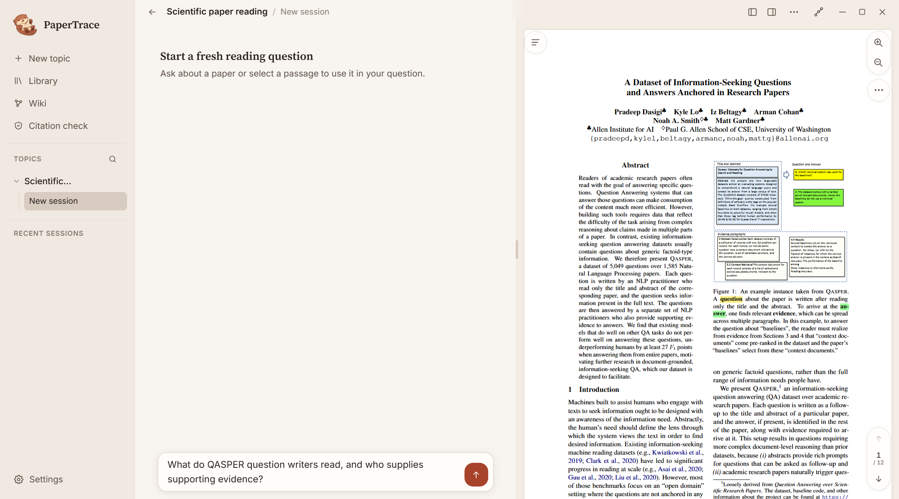
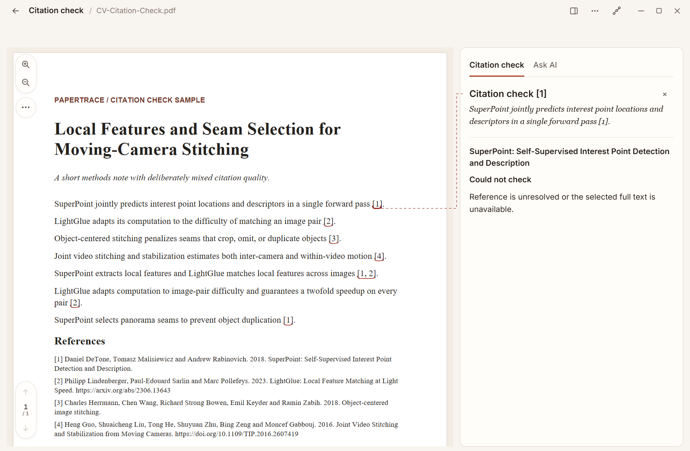
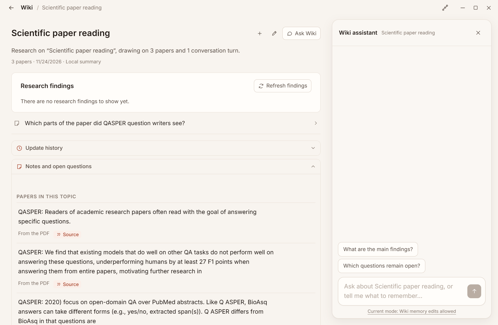

<h1 align="center">PaperTrace</h1>

<strong>这个结论，原文怎么说？</strong>

读论文时，从回答里的引用跳回原段。写论文时，从草稿里的论述追到它引用的文献。

<b>中文</b> · <a href="README.en.md">English</a>　｜　<a href="docs/readme/USER_GUIDE.pdf">图文指南（英文 PDF）</a> · <a href="backend/README.md">启动与配置</a>

## 从一个问题读起

把 QASPER 论文加入主题，打开「阅读与问答」，问一句：**“出题的人能看到整篇论文吗？”**

点击回答旁的引用编号，阅读器会打开这篇论文第 1 页。摘要里区分了两组人：出题者只看标题和摘要，另一组自然语言处理从业者提供答案和证据。在同一会话里继续追问，还可以打开新的引用，逐句对照英文原文。详见图文指南第 3 页。

## 写论文时，核查自己的引用

把被引论文加入主题，再到「引用核查」导入自己的 PDF 稿件。点正文里的引用编号，就能对照稿件原句、参考文献和核查结果。遇到部分支持或相互矛盾的证据，可以打开引文，判断自己的措辞该怎么改。

*指南第 8 页的例子中，稿件引用了 SuperPoint，但主题里缺少它的全文，因此这一处显示「无法核查」。补入被引论文后可以重新核查。*

## 把没解决的问题留给下次阅读

主题 Wiki 把原文摘录、阅读笔记和待回答的问题放在一起。下图的主题同时收录了 QASPER 和 SciBERT。下次打开时，可以问 **“哪些问题还缺证据？”**，也可以从已有条目点回来源，接着上次读到的地方继续。

## 开始使用

1. 按[桌面启动与服务配置](backend/README.md)打开 PaperTrace，配置并测试模型连接。
2. 新建主题，导入一篇有文本层的 PDF。已有文献库也可以导入 BibTeX、RIS、CSL JSON 或 Zotero RDF。
3. 在「阅读与问答」里提问，点击编号核对原文。想了解这次回答实际读了哪些材料，可以查看阅读覆盖范围和智能体轨迹。

论文、批注、笔记和会话保存在本机。使用远程模型时，问题和相关论文片段会发往所选服务商。文献发现会访问 OpenAlex。本分支还可在设置中选择本机 OpenCode，内置智能体是默认选项。

[前端联调说明](docs/product-plan/Backend_Settings_Handoff_ZH.md) · [第三方来源](docs/third-party/README.md) · [开发进展](PROGRESS.md)

HKU COMP7608B · Group 52
