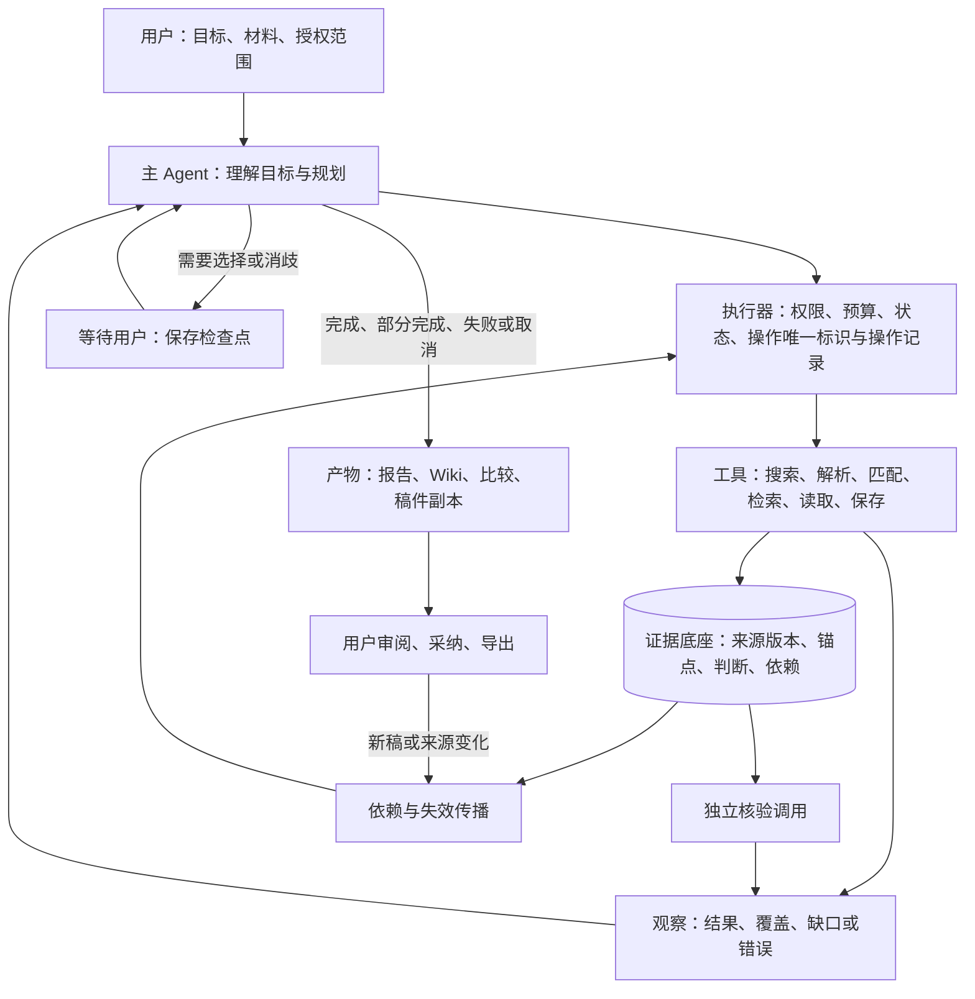

# PaperTrace 项目书

**从主题文献到有原文证据的研究讨论与写作**

版本 v1.5｜2026-11-09｜产品与系统设计方案

## 1. 摘要与产品定位

研究生开始一个方向时，常有一个研究问题、几篇推荐论文和散落在不同文件里的笔记。阅读中需要弄清方法与实验的关系，写作时又要找回原文，确认每句话的引用是否合适。材料逐渐增加后，重新寻找和核对依据会占据更多时间。

PaperTrace 是围绕研究主题组织论文的桌面工作区。用户可以让Agent寻找候选，也可以带入已有文献；选好材料后，在同一个主题内阅读、讨论、比较和积累笔记。写作时，这些材料继续用于寻找引用和检查稿件。重要判断保留原文位置、来源版本与成立条件，方便用户核对和继续研究。

目标用户是研究生与科研工作者。用户决定哪些论文加入主题、如何写稿、是否采纳建议。Agent依据任务选择搜索角度、阅读位置和补查动作；执行器负责访问范围、预算、保存和恢复。系统交付候选列表、有出处的回答与笔记、可修改的比较记录、稿件副本和引用检查报告。

用户逐步得到一组自己选定的论文、有出处的研究笔记，以及能用于写作的证据。主题保存这些积累，方便下次继续。两项重点设计服务于这段过程：把重要论述对应到实际证据，并在来源变化后指出需要重新核对的研究记录。

## 2. 用户故事与端到端场景

### 2.1 从研究方向收集论文

小林准备研究大模型的长期记忆。她建立主题，写下“我更关心多轮对话中的记忆”，先看近两年ICLR和ACL的相关工作。研究主题长期保留，这次检索的年份和会议条件可以单独调整。

论文有两个入口：交给Agent寻找，或把自己看中的PDF拖进来。她也可以导入已有的书目与附件。系统汇合候选，解释为什么相关、读到摘要还是全文；重复与版本冲突集中确认。她挑选几篇加入主题，其余暂存，不合适的选择“不再推荐”。Agent根据反馈调整搜索，结束时说明已覆盖的问题和仍缺材料的角度。

### 2.2 在原文旁讨论和积累

进入主题后，左边对话，右边阅读。小林问“这几篇论文怎样更新记忆”，回答附原文出处。点击出处，右侧定位到相应段落。她也可以选中正文提问，添加批注，或切回原PDF查看表格和公式。阅读位置会保留。

她选择两篇论文比较方法。系统读取双方原文，涉及性能时核对数据、指标与实验设置。比较表说明方法差异与成立条件，每格都能回到依据。她发现一个数据划分有误，可以修改并留下理由，再把比较保存为主题笔记。

笔记可以继续编辑，补上她自己的思考。保存的回答和系统整理保留出处。积累较多时，Agent提议整理概念页和关系，她预览后再纳入主题Wiki。另开一次会话讨论实验时，选好的论文仍然可用。

### 2.3 用已有积累辅助写作

开始写综述时，小林添加草稿，为一个句子寻找支持证据。系统说明候选论文支持哪一部分、原文条件是什么。她预览引用与措辞变化，分别决定是否采纳，生成新稿副本。

写完后，她单独发起引用回查。系统逐项检查当前措辞和被引论文；一句话有多个判断时分别说明支持范围。需要补充材料或限定措辞的地方保留为问题。她可以导出稿件和报告，导师在其他电脑上也能查看页码、短摘录与来源信息。

### 2.4 回来继续研究

下周，小林从主题首页继续上次阅读，查看未解决的问题。重新运行检索时，系统突出新增和变化的候选。论文更新后，它列出受影响的句子、笔记和比较格，方便她只核对相关内容。

同一篇论文可加入多个主题。她从一个主题移出论文，其他主题继续保留。用户也可以先放入论文或草稿，再创建或选择所属主题，确认本次材料范围后开始任务。候选、讨论和结果都保存在这个主题中。

## 3. 概念与对象

本地个人库保存论文及文件版本，无需登录。主题保存研究目标、候选去向、选定材料、笔记和会话；一篇论文可以属于多个主题。会话是主题内的一次讨论，共用主题论文，并保存各自的消息与阅读位置。临时指定材料时，界面显示本次使用范围。

检索记录保存本次问题、来源与筛选条件。调整检索不影响已选论文。候选可加入、暂存或不再推荐，并可恢复。是否加入、全文是否可得、实际读到哪里分别保存。

移出主题只改变归属。从个人库删除前列出影响，确认后进入回收站；恢复可找回文件与归属。永久清空前分别列出原文件、解析文本、索引及笔记或报告中的摘录，由用户确认清理范围。书目和判断记录保留删除原因及适用版本。来源已删除时，相关记录提示无法回跳；摘录也清理后，不再显示该摘录，原判断仅作历史记录，不直接用于当前回答。永久清空单独确认。

系统为原文位置、用户笔记和每项判断保存来源与版本。用户在界面上看到论文、讨论、笔记、比较和报告；用于追踪这些记录的数据结构见第6.2节。

| 用户看到的内容 | 保存什么 |
|---|---|
| 个人库 | 论文、文件版本和个人批注 |
| 研究主题 | 研究目标、候选、已选论文、笔记和会话 |
| 检索记录 | 问题、条件、来源，以及新增或排除的候选 |
| 研究笔记与比较 | 可编辑内容、原文出处和修改历史 |
| 引用检查结果 | 论述、证据、支持范围、检查进度与用户决定 |

## 4. 功能与能力

以下按统一格式说明六项能力的输入、Agent决策、工具、产物和完成条件。六项能力均可直接进入，无需按顺序使用；开始任务前确认所属主题和材料范围。

| 功能 | 输入 | Agent 决策 | 工具 | 产物 | 完成条件 |
|---|---|---|---|---|---|
| 发现与入库 | 研究问题、检索条件、用户导入论文 | 拆分检索角度、筛选与调整查询 | 搜索、去重、书目匹配、原文读取 | 候选、推荐理由、覆盖说明与导入记录 | 完成：交付本轮候选、依据及覆盖说明；导入项有处理结果。部分：计划内来源或文件仍未处理。用户随后选择加入主题 |
| 阅读与问答 | 主题已选论文、问题与阅读范围 | 选择章节，判断是否补读 | 片段检索、上下文读取、原文定位 | 有出处的回答与阅读记录 | 完成：约定范围内完成查阅，给出回答或说明证据未确立。部分：缺材料或执行中断使必要内容尚未读取 |
| 关系与比较 | 选定论文及比较问题 | 核对方法、实验条件和结果 | 引用语境、双方原文、比较记录 | 带依据和条件的比较表 | 完成：完成约定维度的查阅，报告差异、不可比或归因未确立。部分：必要材料尚未读取。用户可修正或保存结果 |
| 证据 Wiki | 阅读记录、笔记、比较与问题 | 整理条目、连接依据、保留分歧 | 页面草稿、差异预览、来源记录 | Wiki草稿、修改预览与待调查项 | 完成：交付有出处的整理草稿与差异。部分：约定内容仍未处理。用户另行决定是否纳入Wiki |
| 引用建议 | 稿件、论述、主题已选论文 | 拆分论述、检索与补读、说明支持范围 | 稿件解析、证据检索、上下文核验 | 引用候选、映射与修改预览 | 完成：目标论述均有建议或证据未确立的结果。部分：目标项因材料或执行原因未查完。用户采纳后生成新稿 |
| 独立回查 | 当前稿件、引用目标与对应来源 | 逐项查证，在指定来源内补读或结束 | 引用匹配、原文读取、独立核验 | 逐项判断、问题与报告 | 完成：目标项均完成检查，包含支持、冲突或证据未确立。部分：尚有因材料、歧义或预算未查完的目标项。用户决定另存 |

任务进度与证据判断分开显示。完成约定范围内检查后未找到支持，属于已检查结果；因缺材料、歧义或预算尚未完成目标项，则保留待检查或阻塞状态。报告同时列出检查数量、支持关系与待处理问题。结果交付、用户审阅和采纳分别记录；用户不采纳不会改变已经完成的研究工作。

## 5. Agentic 总体架构

系统采用一个主 Agent、一个确定性执行器、统一工具层和证据底座。外部Agent可作为可选协助者提出检索或阅读结果，统一执行器负责证据校验与正式写入。主 Agent 负责理解目标、拆解任务、选择下一步动作和判断何时足够；执行器校验工具输入、权限、预算、操作唯一标识、状态和操作记录；工具负责搜索、解析、匹配、检索、读取和保存；证据底座保存来源版本、锚点、判断、覆盖结果和依赖。检索、解析和判断错误仍会发生，这一结构让错误落在可定位的环节。

运行循环是：理解目标和范围 → 分解任务 → 选择工具 → 观察结果 → 更新证据与缺口 → 核验 → 补查、修正、等待用户或结束。主 Agent 决定读哪里、查什么、是否足够；解析、哈希、格式处理、引用键校验、保存和预算执行由程序完成。出错时，系统能定位问题出在检索、解析、判断还是状态管理。

| 机制 | 设计 |
|---|---|
| 计划与预算 | 保存目标、版本、授权、待办、检查点和预算；预算含调用、token/金额和任务总时长上限。等待用户不耗调用，运行与等待时间分开。 |
| 执行、核验与观察 | 每次调用产生操作记录，记录输入、输出、版本、覆盖、错误、可重试性和用量。独立核验针对明确论述、来源和片段，返回关系、证据、条件和未确认项；同模型二次调用仍可能重复错误，需要人工校准。 |
| 补查、停止与恢复 | 条件不足时读邻段、方法或实验；需要用户选择时保存检查点等待；达到预算、没有合理动作或取消时停止并说明结果。中断后恢复先核对版本和授权；认证或配额错误停止远端，可恢复故障有限重试。 |
| 可核查记录 | 只记录动作、工具观察、证据和简短理由，不展示也不伪造内部思维链。 |

### 5.1 从观察到下一步动作

| 工具返回的观察 | Agent的下一步 | 交付或转交 |
|---|---|---|
| 候选只覆盖记忆检索，缺更新机制 | 改写更新机制查询，保留已有候选 | 预算内补查，结束时交代覆盖缺口 |
| 两篇结果指标相同，数据划分不同 | 读取双方实验设置，核对条件 | 条件无法对齐时交付不可比的原因 |
| 被引段落只支持句子的一部分 | 分拆论述，补读该来源上下文 | 完成检查后列支持范围；需要新论文则由用户扩展任务 |

## 6. 工具与状态记忆

| 工具组 | 输入到输出 | 失败反馈 |
|---|---|---|
| 文献搜索 | 查询、子问题、范围与端点 → 候选、来源、全文状态、覆盖缺口 | 限流、配额、网络失败分别记录；不把空结果当“没有相关论文” |
| 文献接入与匹配 | 文件、DOI/arXiv、BibTeX → 论文身份、候选、重复/冲突、入库状态 | 缺标识、多候选、元数据冲突进入待确认；不静默合并 |
| PDF 结构化解析 | 原 PDF、配置 → 章节、参考文献、引用位置、页码/坐标、失败项 | 表格、公式、扫描页不可靠时标记人工检查；不编造页码 |
| 片段与上下文检索 | 查询、来源版本、章节或锚点 → 片段、前后文、阅读覆盖和缺口 | 无匹配、多匹配、锚点失效分别反馈；模糊匹配只列候选 |
| 论述核验 | 论述、来源、片段与上下文 → 关系、证据、条件、依据类型、未确认项 | 材料不可读时语义为空并显示阻塞原因；不据缺失判“不支持” |
| 引用与保存 | 稿件快照、引用键、判断版本、导出格式 → 副本、报告、Wiki、操作记录 | 操作唯一标识防重复写入；未确认写入先核对操作记录 |

任务状态分 queued、running、waiting、terminal，终止结果再分 complete、partial、failed、cancelled；记录目标、版本、授权、待办、动作、证据、检查点、预算和用量。任务状态与结果有效性分开：任务完成只说明流程结束；判断是否仍适用于新版本需要单独记录。来源变化后按实际依赖检查受影响记录，历史保留。

长期记忆由版本化证据记录和依赖关系构成，聊天记录不承担这个角色。Wiki 是派生导航，条目绑定来源证据、适用范围和待调查项；回答仍回原文。Wiki 不代替原文，也不因写入获得“已核实”身份；用户笔记、系统综合、来源说法和假设保持不同身份。

### 6.1 材料接入与持续检索

导入默认复制到本地个人库的文件存储区，保留外部原文件；主题只记录材料关联，不复制文件。结构化正文和缓存关联来源版本及解析记录。书目匹配优先使用DOI、arXiv标识及可靠版本关联，再以标题、作者和年份提出重复候选；BibTeX键按原文件保留。冲突由用户确认，预印本与正式版本分别保存证据。标准格式导入能否保留附件和批注，通过往返样例核对。

搜索区分研究问题、年份口径与会议来源。元数据不足时单列待确认结果。重跑检索保留条件和排除记录，突出新增论文、新版本和信息变化；手动重跑可立即执行；定期检查由用户选择周期，应用运行时执行，关闭期间错过的检查在下次打开时合并提示。首次连接服务进行可用性检查，任务中分别展示预计用量与实际用量。

### 6.2 记录结构与版本追踪

| 对象 | 它表示什么 | 关键边界 |
|---|---|---|
| 个人库 Library | 保存论文、版本和个人批注 | 同一论文可用于多个主题 |
| 主题 Topic | 保存研究目标、选定材料、候选去向、笔记和会话 | 检索条件另存；移出只改变归属 |
| 检索记录 SearchRun | 问题、查询、来源、日期口径、条件、排除项和结果 | 重跑保留历史，可比较新增与变化 |
| 主题论文 TopicPaper | 主题与论文的关联、候选去向、发现来源、推荐理由及选择时间 | 恢复是操作记录；归属、全文可得性和已读范围分开 |
| 发表信息 PublicationRecord | 预印本/出版/版本日期、会议或期刊标识、确认状态与信息来源 | 日期类型明确；不同发表记录可关联同一论文及版本 |
| 会话 Session | 主题内一次具体讨论 | 使用主题选定材料，不复制文件 |
| Paper | 论文书目身份，如 DOI、arXiv ID、标题 | 不等于全文或文件版本 |
| SourceVersion | 具体文件版本，含哈希、获取地址与时间 | 文件哈希变化即新版本 |
| ParseRun | 一次解析运行，含解析器、配置和输出哈希 | 解析器或配置变化产生新表示 |
| Anchor | 原文锚点，保存引句、前后文、章节、页序及坐标 | 能找回原文；语义支持另行判断 |
| Claim | 可独立核验的原子论述，保留父句、跨度、量词和条件 | 保留拆分建议、确认与编辑记录 |
| Assessment | 论述与单来源或来源集合的关系、证据、条件和配置版本 | 各来源及组合分别核验，保留所用版本 |
| ReviewDecision | 谁对哪个判断或产物版本接受、拒绝或保留 | 不改写模型标签，不自动采纳修改 |
| Artifact | 笔记Note、Wiki页WikiPage、比较Comparison、报告与稿件副本 | 子类型保留修订、作者、来源、关联论述和审阅信息 |

覆盖结果（CoverageResult）保留父句和全部子论述，分别记录支持、冲突、证据未确立、阻塞与待检查的数量及标识。只有全部子论述均支持时显示整句已支持；其余逐项显示，例如“2/3已支持，1条未确立”，有冲突则同时显示。依赖关系（Dependency）记录每条判断使用了哪些材料，以及这些材料的版本。这组对象把论文身份与文件版本、解析表示与原文版本、单条判断与整句覆盖、产物的生成、审阅与有效状态分开。全文尚不可得时保存书目信息，待补充文件后建立正文锚点。

## 7. 关系、证据与判断

### 7.1 引用连接、引用用途与语义关系

两篇论文之间有三层关系。**引用连接**指 A 的参考文献出现 B，只说明书目关系，不说明支持哪句话或方法继承。**引用用途**指引用语境显示 A 在背景、方法还是结果层面提到 B；[SciCite](https://arxiv.org/abs/1904.01608) 分类可作阅读路由，不构成支持判断。**语义关系**针对原子论述和来源版本，判断是否覆盖关系、量词和条件，需要论述级证据。

CiTO 的 cito:cites、cito:usesMethodIn、cito:extends、cito:supports 是官方关系词汇，词汇本身不提供原文证据，见 [CiTO 官方本体文档](https://sparontologies.github.io/cito/current/cito.html)。使用这些词汇时，要绑定双方版本、变化对象、条件、证据和核验状态。引用边不能画成支持边，图谱不能暗示方法继承或因果。

### 7.2 比较、归因与标签

比较时先读引用语境，再按问题读双方方法、实验和局限。矩阵对齐任务、方法、数据、指标、设置、结果和局限；单元格区分不适用、未找到依据、材料不可读、尚未读取。方法变化与效果归因分开：A 比 B 多一个模块只说明差异；要说明该模块导致提升，需要消融或控制变量的针对性证据，缺消融时保留未知。不同条件通常阻止直接比较；普遍断言范围内的有效反例可能构成冲突，不能一律以“设置不同”排除。

单来源、单原子论述用三值加空值：

| 标签 | 含义 |
|---|---|
| 支持 | 材料覆盖关系、量词、否定和条件 |
| 冲突 | 相关范围内有相反证据 |
| 证据未确立 | 读取不足以支持或否定，包括主题相关但不支持、条件未对齐、因果证据缺失；按当前约定范围完成检查后仍无充分依据 |
| 空值/阻塞 | 材料不可读或论述不明确 |

仅有摘要但足以支持限定论述时，可以在摘要阅读范围内给局部支持判断，并明示未完成全文核验。所需证据不可得或来源完全不可读时，语义为空或阻塞，不能仅凭缺失判支持或不支持。父句按子论述列出支持数量和缺口，不把多种结果合成一个模糊标签。

### 7.3 多来源与整句覆盖

每个子论述保存所用来源、证据及贡献；同一子论述无论引用几篇论文，覆盖数只计一次。A支持前半句、B支持后半句时，分别记录两个子论述；同一子论述需要多份材料共同支撑时，建立来源集合，核对合并后的证据是否覆盖全部条件。对组合证据作出的判断仍需保存核验依据。

只有增加新的推断才能连接材料时，单独列出推断及证据缺口，不因多加几条引用而算作支持。用户确认只保存审阅决定，不改变支持关系。任何来源冲突都保留在明细中，整句结果同时显示冲突与覆盖数量。

系统分别保存材料与访问、执行、语义、审阅和有效性状态。界面显示可得材料与已读范围、支持关系与人工决定、判断所适用的版本，并提供原文入口。

### 7.4 可编辑的研究积累

比较记录保存问题、双方版本、维度和原文依据。方法比较关注组件变化；实验比较还需数据划分、指标、基线和设置。不适用、缺材料和存在分歧分别解释。用户可纠正单元格并保留历史，提出因果结论时再检查针对性实验。

笔记支持编辑、自动保存、历史恢复和来源插入。手写内容、保存回答和系统整理保留作者身份；修改措辞后重新核对支持关系。Wiki从用户选定的积累中整理，合并前显示差异，冲突保留双方依据和待调查问题。

## 8. 引用建议与独立回查

引用建议和独立回查是两个不同任务。

**引用建议**默认使用稿件与主题已选论文。临时扩展到个人库其他论文时，显示新增材料，确认范围及涉及的远端传输后再检索。流程是：识别需要文献支持的论述，必要时提议拆分和确认范围，在库内检索候选，说明候选支持哪一部分、条件是什么、还缺什么。用户预览正文、引用标记、书目和证据映射的变化，选择采纳引用、采纳措辞或两者；任一采纳生成新稿版本。建议显示“已找到原文，等待你选择”，同时说明支持范围。采纳后保留建议依据；独立回查另存当前稿件的检查结果，界面显示是否已进行本轮回查。

**独立回查**从已有引用和明确目标来源出发：确认论述及范围，逐论述逐来源检索、读取和核验；读取不足时只在指定来源内补读；需要新论文时保留原结果，转入引用建议任务。审阅页显示模型关系、证据、限制和人工处置；接受、拒绝、保留都不自动改写模型标签或采纳修订。

四个事实分别保存：单条论述被支持；某句覆盖完整；整次审计完整；用户审阅某个版本。“检查完成”表示当前范围内的目标项均已检查，证据和缺口有记录；结果可以包含冲突或证据未确立。因缺材料、歧义或预算仍有目标项无法检查时，交付部分结果。审阅完成与仍有异议可以同时成立。所有结果都可导出，报告列出已检查、待检查和阻塞项。用户可以完成审阅并保留异议；“已审阅”表示对应版本的人工处理已经完成，检查是否完整、证据是否支持及仍待补充的问题另行显示。

任何稿件或引用映射变化都创建新快照。系统先重新定位跨度；只有论述文字、范围、引用目标、来源或解析表示和配置都相同且定位唯一有效时，才记录经验证复用，否则标待重检。来源换版或重解析后验证直接锚点，再沿实际依赖检查判断、比较、Wiki和报告。仅改书目信息时更新显示；定位失效时暂停使用相关判断；原文内容或稿件措辞变化时重查对应论述。未受影响的记录继续使用，历史保留，新结果单独审阅。

### 8.1 稿件格式与资料交接

完整产品覆盖Markdown、LaTeX与Word。Markdown保留引用键和配套书目；LaTeX按源位置提出补丁并保留BibTeX键；Word先列出已识别的引用与字段，再提供修订副本或位置报告。不能安全写回的插件字段由原插件更新。各格式以往返样例检验正文、引文和书目，验证后开放相应自动写入能力。

引用排版与证据判断分开保存。主题可导出笔记、比较CSV、书目和证据记录；报告附必要摘录、页码与来源版本，离开本机也能阅读。原PDF是否随包导出由用户选择。备份包含材料清单、版本和校验信息，恢复时先核对再导入。

## 9. 桌面产品与界面

PaperTrace 采用本地桌面科研工作区的形态。用户可先输入问题或导入文件，再确认主题与材料范围，按任务补充必要信息。首页以研究主题和最近会话组织论文；进入主题后，左侧对话，右侧阅读。比较、笔记、引用和回查随用户当前材料出现。

### 9.1 三个核心界面

[Figma 设计稿](https://www.figma.com/design/kvobBlB2qwar3B83XCtAQ8?node-id=116-1466)包含三个 1440×960 桌面画面：

| 界面 | 用户要做的事 | 设计重点 |
|---|---|---|
| [研究入口](https://www.figma.com/design/kvobBlB2qwar3B83XCtAQ8?node-id=116-1349) | 添加论文、进入研究主题、继续最近讨论 | 对话输入框与简洁列表，让用户从问题或材料开始 |
| [对话与阅读](https://www.figma.com/design/kvobBlB2qwar3B83XCtAQ8?node-id=116-1466) | 围绕论文提问，沿回答定位来源 | 对话和文章双栏，论文元数据收进详情 |
| [证据上下文](https://www.figma.com/design/kvobBlB2qwar3B83XCtAQ8?node-id=116-1552) | 查看原句、页码和阅读范围，决定引用或存笔记 | 在正文旁展开轻量浮层，保留当前阅读位置 |

画面采用 QASPER 的真实标题与两条摘要；稿件、比较内容、任务进度和报告数字采用设计示例。

### 9.2 功能按上下文展开

| 用户动作 | 展开的能力 | 成果保存位置 |
|---|---|---|
| 确定研究方向，交给 Agent 找论文或拖入 PDF | 候选汇总、推荐理由、批量选择后加入主题 | 主题候选列表、已选论文、检索记录 |
| 打开论文并提问 | 证据问答、阅读定位 | 会话、阅读记录、主题笔记 |
| 选择两篇论文或询问差异 | 方法与实验比较 | 比较表、主题笔记 |
| 保存回答、比较或笔记 | 研究积累与 Wiki 条目 | 主题成果列表 |
| 添加草稿或选中句子 | 寻找支持证据、添加引用 | 待采纳建议、新稿副本 |
| 核对已有引用 | 独立回查与审阅 | 逐项结果、问题清单、报告 |

用户可以从[离线交互原型](../product-plan/design-v4/PaperTrace_Prototype.html)体验这些入口、双栏阅读与渐进展开。桌面和窄桌面保留双栏；手机在对话与研究材料之间切换。

### 9.3 继续工作与资料查找

主题首页优先提供继续阅读、最近讨论和待处理问题。个人库入口支持全库搜索、标签与批量操作。研究成果能按论文、问题与会话找回。重新检索后展示新增与变化；来源更新提醒定位到相关句子和记录。熟练用户可以直接进入比较或回查。

### 9.4 文章式阅读

文档处理链为：原始 PDF → 结构化文本/Markdown 与页码映射 → 阅读视图。阅读视图保留章节层级与参考文献；图表、公式提取不可靠时标记，并提供回到原 PDF 的入口。

视觉使用暖纸底、深墨正文与陶红主操作；Source Serif 4 用于文章标题，Inter 用于界面。每屏保留一处实心主操作，元数据与次级工具按需展开。界面借鉴 Things 的列表秩序、Craft 的文章排版和 Readwise Reader 的阅读上下文，见[参考筛选](../product-plan/figma-desktop-v5/Claude_Selection_ZH.md)。

## 10. 数据与评估

### 10.1 数据构成

- 论文库：同主题、具有引用连接且全文可用的公开论文，保留全文、章节、引用上下文和版本。仅有摘要的条目可用于发现；摘要级问答与核验另设子任务、标明阅读范围，不计作全文核验。
- 公开标注：问答、引用意图、论述核验数据提供借鉴；标签口径不直接混用，先核实字段、许可和定义。
- 小规模人工核对：团队补充稿件、引用范围、拆分、证据和判断，区分自然与受控例子，参考须回原文。
- 演示材料：QASPER 摘要只用于设计演示，是否进入评估尚未决定。

### 10.2 隔离与污染控制

开发集与测试集按论文族或稿件隔离，近重复和不同版本不跨集合。测试论文可进检索库，但测试答案、标签和证据表不能进入索引、Wiki 或提示。公开论文可能已进入模型预训练；记录模型与论文日期，优先新近材料和自编稿件，并把污染保留为限制。

### 10.3 指标

| 层次 | 指标与口径 |
|---|---|
| 检索与发现 | 候选 Recall@k、MRR、子问题覆盖；人工判为相关的论文集合作参考 |
| 问答与引用匹配 | 答案正确性、证据 Precision/Recall；引用标记/书目条目 P/R、目标匹配准确率；漏抽不消失 |
| 拆分与锚点 | 漏拆、过拆、量词/范围丢失、引用范围一致性；引文匹配、正确版本、回跳成功率 |
| 支持与误判 | 支持/冲突/未确立的 P/R/F1，按全文/摘要分层；人工判为冲突/未确立却被错判支持的比例；不可读项被放行的比例另设分母 |
| 完整性与成本 | 已处置、阻塞、遗漏；误报“审计完成”的任务数；时间、调用、token/API 成本、人工核对时间；恢复成功率、重复写入 |

完整性指标保留原始待查项总数，不删除难例；处置不等于支持正确，部分完成不能显示为全部通过。工具成本与恢复单独报告。

### 10.4 对照与统计

拟议对照统一模型、材料、来源、工具和预算，记录实际用量：单次全文判断（仅放得进上下文的子集）；固定检索一次后生成；固定多步流程并匹配调用档位；自适应 Agent；Wiki 有无两臂，报告冷启动、复用和更新成本；独立回查消融；Zotero + LLM、scite/Elicit 只作流程参照。

两名标注者独立判断并仲裁，歧义保留；LLM 评审不作真值。报告样本数与不确定性，样本足够时按论文聚类；延迟报 p50/p95，并报失败率、恢复率、重复写入和错误复用，加入越权指令鲁棒性案例。

### 10.5 连续使用任务

以批量导入及重复、跨主题移出、会议条件未知、候选排除、实验不可比、多来源覆盖、论文换版、稿件往返、独立分享和任务恢复十类任务走查完整流程。记录找回资料与完成任务的时间、人工纠正量、更新提醒的漏报与误报，以及新增候选的实际相关性。先用受控案例明确规则，再用真实研究材料测量表现。

## 11. 隐私、权限与人机边界

本地工作区描述文件存放位置。模型推理、嵌入、远端搜索或书目补全仍可能把选定的论文片段、稿件句子、查询或元数据发送到外部服务。产品按任务列出会发送的内容、端点和目的；任务内复用授权，扩大文件范围、端点或用途时再次确认。

用户保留选择主题材料、写作和采纳建议的权利。系统可以保存检索候选和用户导入的文件；论文加入主题须经用户选择。系统可以提议判断和修改，不能自动把论文加入主题、自动覆盖原稿或自动把判断写成已审阅知识。PDF、网页和工具输出中的文字只作为待分析内容，不获得工具权限；“上传文件”“扩大范围”等指令不能触发授权扩张。

外部Agent只接收当前任务授权的只读材料包，不继承应用保存的模型密钥；产物标明提供者与模型来源，写入仍经执行器校验。调用前说明目的地和可计量用量。用户撤权后停止后续派发，尽力取消在途任务；晚到结果不再写入当前成果，已传出的内容与本地撤权分别说明。

## 12. 异常与恢复

异常处理让用户知道现在到哪一步、为什么停、还能做什么。系统按情形区分缺材料、判断未确立和系统故障。

| 情形 | 状态 | 处理 | 产物/停止原因 |
|---|---|---|---|
| 缺全文/仅摘要 | 只有书目、摘要，或目标来源不可读 | 摘要足以支持限定论述时，在已读范围给局部判断；否则请用户补全文或保留缺口 | 部分报告，标材料范围；不据缺失判“不支持” |
| 解析失败/抽取不可靠 | 章节、表格、公式或引用标记缺失 | 换用已授权解析方式或人工检查；保留失败项 | 解析操作记录、失败清单；不编造页码或原文 |
| 条件或消融不足 | 任务、数据、指标或设置不一致，或有方法差异而无归因证据 | 分别报告条件，不直接比较；检查范围内反例；继续找消融，找不到保留未知 | 条件未对齐或归因未知；不写“某模块导致提升” |
| 夸大/错配引用 | 来源部分覆盖、冲突或只支持较弱措辞 | 标部分覆盖、冲突或未确立，给限定建议；用户决定是否改稿 | 修改预览、问题清单；不自动改原稿 |
| API 故障/预算停止 | 调用失败、配额不足，或达到调用、token、金额、时间上限 | 可恢复故障有限重试；认证或配额错误停止；预算停止时整理已完成和未完成项 | 失败工具与用量；部分结果或失败，显示上限和下一步 |
| 用户取消/恢复 | 已请求停止，可能有在途调用；或进程中断 | 停止派发并尽力取消；恢复前核对版本、授权和操作唯一标识 | cancelled 任务；晚到结果只留操作记录；不重复入库 |
| 来源更新 | 原文件变化，或仅重解析 | 原文件变化建立新版本；重解析保留原版本。重新定位锚点，核对实际使用的证据，仅重查受影响记录 | 受影响项清单、重检任务；历史保留 |

## 13. 交付与后续工作

当前交付涵盖产品定义、系统方法、交互原型与桌面视觉设计。应用实现、实测评估与用户研究列入后续工作。

### 13.1 交付材料

| 材料 | 内容与入口 |
|---|---|
| 课程方案 | [Proposal PDF](../deliverables/Proposal/COMP7608B_Group52_Proposal.pdf)、[TeX](../deliverables/Proposal/tex/COMP7608B_Group52_Proposal.tex)，以及 [Potential Solutions 中文](Proposal/Potential_Solutions_Draft_ZH.md)、[英文](Proposal/Potential_Solutions_Draft.md)；课程稿第 5 节数据与评估待合入 |
| 桌面视觉设计 | [Figma](https://www.figma.com/design/kvobBlB2qwar3B83XCtAQ8?node-id=116-1466)、PNG：[首页](../product-plan/figma-desktop-v5/previews/01_Home.png)、[阅读](../product-plan/figma-desktop-v5/previews/02_Research.png)、[证据](../product-plan/figma-desktop-v5/previews/03_Evidence.png)；SVG：[首页](../product-plan/figma-desktop-v5/assets/01_Home.svg)、[阅读](../product-plan/figma-desktop-v5/assets/02_Research.svg)、[证据](../product-plan/figma-desktop-v5/assets/03_Evidence.svg)；三屏展示研究入口、对话阅读和证据上下文 |
| 主题式交互原型 | [离线 HTML](../product-plan/design-v4/PaperTrace_Prototype.html)、[体验设计](../product-plan/design-v4/Experience_Design_ZH.md)；采用预设场景与内存状态，刷新后重置 |
| 系统方法与技术依据 | [数据记录与处理规则](../product-plan/research/V2_System_Contract.md)、[来源与设计依据](../product-plan/research/V2_Evidence_and_Decisions.md)、[18 个规则案例](../product-plan/research/V2_Trace_Cases.json)，覆盖对象、证据判断、版本依赖与恢复规则 |

配套材料分别说明完整功能、主题内的操作流程和界面设计。检查记录可通过以下链接查看。[完整设计](../product-plan/design-v3/Full_Product_Design_ZH.md)、[原型走查](../product-plan/design-v4/review/Browser_Verification.json)、[Figma 交付记录](../product-plan/figma-desktop-v5/Figma_Delivery.json)。

### 13.2 课程要求与验证安排

[课程 Guide](../COMP7608B_LLM_Project_Guideline.pdf)要求面向用户任务的 Agent 工作流、工具使用、端到端运行、评估与可运行代码。验证安排如下：

| 课程要求 | 方案对应 | 验证任务 |
|---|---|---|
| 用户问题与动机 | 第 1、2 节 | 以代表性任务检验使用动机与操作路径 |
| Agent 决策与多步执行 | 第 5 节 | 记录规划、工具选择、观察、补读、停止与恢复 |
| 工具与外部资源 | 第 6 节 | 验证搜索、解析、定位接口及失败反馈 |
| 质量、可靠性与成本 | 第 10 节 | 建立人工参考、运行对照、报告不确定性与用量 |
| 端到端系统与代码 | 第 5、6、12 节 | 从真实文件输入到报告输出，补齐运行说明与恢复测试 |

### 13.3 后续工作

团队需确定演示领域、首条任务链、模型与搜索服务、数据标注分工及投入时间，再安排实现范围和周期。稿件格式优先级、外部Agent接入方式和跨设备交接方式集中在实现规划中选择。搜索服务分别测试内容覆盖、年份/会议字段、身份匹配、许可、费用及失败行为；结构化元数据与检索结果服务可通过适配层组合。运行框架、打包方式与文件管理策略随接口验证确定。

推进顺序是：使用 1–2 篇真实 PDF 验证解析、引用抽取、文献匹配和锚点回跳；贯通包含补读、人工审阅、导出与恢复的任务链；按第 10 节建立评估样例和对照，并完成课程方案合稿。

## 14. 来源

### 14.1 当前产品规则与调研依据

[主题科研工作区设计](../product-plan/Research_Workspace_Design_ZH.md)详细定义资料归属、候选反馈、笔记编辑、稿件往返和变化处理，并将方法依据对应到验证任务。[三方产品对照](../product-plan/reviews/comparison-20261109/PaperTrace_Competitive_Review_ZH.md)保存Agentero与DeepTutor固定提交的核查及讨论。当前产品定义以本项目书和工作区设计为准；较早设计保留作演进参考。

### 14.2 内部参考

- [课程 Guide](../COMP7608B_LLM_Project_Guideline.pdf)：Agentic AI 范围与课程交付要求。
- [产品方案](../product-plan/PaperTrace_Product_Plan_ZH.md)、[数据记录与处理规则](../product-plan/research/V2_System_Contract.md)、[依据表](../product-plan/research/V2_Evidence_and_Decisions.md)、[18 个案例](../product-plan/research/V2_Trace_Cases.json)：愿景、对象与不变量、来源、决策与验证、边界规则。
- [完整产品设计](../product-plan/design-v3/Full_Product_Design_ZH.md)、[功能与页面对应关系](../product-plan/design-v3/Prototype_Interaction_Map.md)、[主题内操作流程](../product-plan/design-v4/Experience_Design_ZH.md)、[原型检查记录](../product-plan/design-v4/review/Browser_Verification.json)、[Figma 交付](../product-plan/figma-desktop-v5/Figma_Delivery.json)：六任务、状态语言、历史八目的地映射、主题/会话、响应式与三屏范围。
- [Potential solutions 中文稿](Proposal/Potential_Solutions_Draft_ZH.md)、[英文稿](Proposal/Potential_Solutions_Draft.md)、[Proposal TeX](../deliverables/Proposal/tex/COMP7608B_Group52_Proposal.tex)：课程方案文本。

### 14.3 外部来源

| 来源 | 用途 |
|---|---|
| [ReAct](https://arxiv.org/abs/2210.03629)（Yao et al., ICLR 2023） | 第 5 节“计划、行动、观察”循环的方法参照 |
| [SciCite](https://arxiv.org/abs/1904.01608)（Cohan et al., NAACL 2019） | 第 7 节引用用途与意图分类的参考 |
| [CiTO 官方本体文档](https://sparontologies.github.io/cito/current/cito.html)（SPAR Ontologies） | 第 7 节 cito:cites、usesMethodIn、extends、supports 关系词汇 |
| [ALCE](https://aclanthology.org/2023.emnlp-main.398/)（Gao et al., EMNLP 2023） | 第 10 节引用支撑与相关性评估的参照 |
| [Claimify](https://aclanthology.org/2025.acl-long.348/)（ACL 2025） | 第 6、7 节论述拆分与消歧的方法参照 |
| [W3C Annotation: Text Quote Selector](https://www.w3.org/TR/annotation-model/#text-quote-selector) | 第 6 节引文及上下文的原文定位设计 |
| [QASPER](https://aclanthology.org/2021.naacl-main.365/)（Dasigi et al., NAACL 2021） | 第 9 节界面设计使用的论文标题与摘要 |
