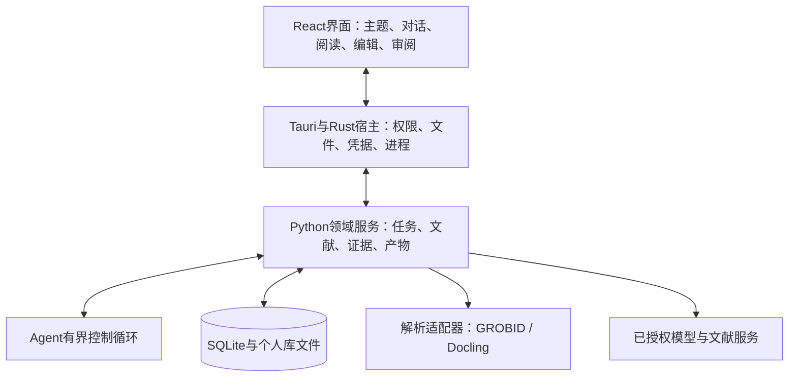

# PaperTrace 开发技术书

**把主题科研工作区做成可持续运行的桌面应用**

技术方案 1.0｜2026-11-09｜产品基线 v1.5

## 1. 开发目标与阅读顺序

PaperTrace的开发要连接六类工作：发现与整理文献、阅读问答、论文比较、研究笔记与Wiki、引用建议、独立回查。它们共用个人文献库、主题材料、原文位置和版本记录。用户从任一入口开始，研究结果都能保存、找回、修改和导出。

这本技术书给出推荐架构、模块职责、数据与接口草案，以及验证选型的方法。先读第2—4节了解整体路线；第5—11节对应开发模块；第12—16节说明权限、测试、打包、协作与来源。文中的接口和目录为拟议设计，依赖版本在技术试验后锁定。

核心工程目标是让一次研究动作留下可继续使用的结果：选定材料后开始任务，Agent依据观察选择搜索或补读，程序保存证据和操作记录，用户查看与采纳；任务中断或来源改变后，系统仍能解释哪些结果有效、下一步从哪里继续。

## 2. 推荐技术栈

### 2.1 主线

推荐采用React与TypeScript构建界面，Tauri 2承载桌面能力，Rust作为薄宿主管理进程和系统权限，Python工作进程承载研究逻辑。SQLite保存领域数据和全文索引，原始文件保存在个人库。PDF.js负责原PDF阅读，GROBID提供学术结构与引用位置，Docling承担复杂版面与OCR扩展。

| 层次 | 推荐技术 | 在本项目中的职责 |
|---|---|---|
| 界面 | React、TypeScript、Vite | 主题、左聊右读、比较、笔记和审阅；沿用既有设计语言 |
| 桌面宿主 | Tauri 2、少量Rust | 文件选择、能力控制、密钥调用、Python生命周期、安装升级 |
| 研究服务 | Python、Pydantic | 任务接口、数据校验、解析适配、检索、证据判断与导出 |
| Agent控制 | 自有Python任务循环（显式状态机） | 规划、工具选择、等待、补查和恢复；LangGraph为替代试验；写入经应用服务 |
| 事实数据 | SQLite、迁移脚本 | 论文、主题、版本、证据、判断、人工决定及任务记录 |
| 检索 | FTS5、向量适配器 | 关键词与语义召回、主题过滤、合并排序 |
| 阅读与解析 | PDF.js、GROBID；Docling扩展 | 原文阅读、结构化正文、书目、引用与坐标映射 |
| 编辑与Wiki | Tiptap、受控Markdown渲染 | 可编辑笔记、来源节点、比较嵌入、知识导航 |
| 引用与文档 | BibTeX/CSL JSON、Pandoc适配 | 书目互通、引文排版、稿件副本与报告 |
| 工具链 | pnpm、uv、Rust工具链 | 分别锁定前端、Python与宿主依赖 |
| 验证 | pytest、前端组件测试、WDIO桌面测试 | 领域规则、接口、真实桌面路径与安装验收 |

这些组件形成一个本地模块化应用。产品事实集中在领域服务中，界面不直接写数据库。远端模型、文献接口和可选解析服务通过适配器接入。Agent控制也可以交给成熟harness，作为与本章并列的替代路线，见8.4。

### 2.2 为什么保留Electron替代路线

Tauri适合将系统能力集中到薄宿主，但增加Rust、系统WebView和Python二进制的联调。Electron提供主进程、渲染进程和preload的成熟分工；如果团队以TypeScript为主且没有维护Rust的能力，可保留同一Python协议和领域服务，替换桌面宿主。不能仅凭框架宣传判断启动时间、内存和安装体积，要用同一PDF与同一任务实测。[Tauri sidecar](https://v2.tauri.app/develop/sidecar/) · [Electron进程模型](https://www.electronjs.org/docs/latest/tutorial/process-model)

切换依据集中在三个试验：目标系统能否独立启动Python、PDF阅读与定位是否稳定、团队能否维护打包和权限配置。界面与领域逻辑不随宿主重写。

## 3. 进程架构与职责



界面负责显示与交互，不自行决定某条引用已经通过。Rust宿主负责启动已打包的Python程序、转发消息、授予受限文件访问并管理系统凭据。Python领域服务是业务规则与领域数据库的唯一写入入口。解析工作可在子进程或服务执行，返回结果后统一提交。

Agent负责提出下一动作，不能绕开领域服务直接修改论文、笔记或判断。读取论文时使用材料标识和授权快照，避免模型自行构造任意文件路径。操作系统文件路径仅在受控宿主和接入服务中解析。

### 3.1 默认通信方式

桌面主线采用标准输入输出上的JSON-RPC 2.0消息：一条UTF-8 JSON占一行，stdout只承载协议，日志进入stderr。Rust通过Tauri command接收界面操作，通过Channel转发增量事件。长任务先返回task_id，进度、文本增量和最终产物由后续事件通知。[Tauri通信机制](https://v2.tauri.app/develop/calling-frontend/)

本机HTTP不是默认入口。需要浏览器独立访问或远程部署时，再用FastAPI实现同一应用接口，绑定回环地址并验证会话令牌、来源、上传限制和生命周期；SSE属于该HTTP路线，不能直接套到stdio。两种传输共用领域接口，不同时维护两套业务状态。

### 3.2 协议草案

```json
{"jsonrpc":"2.0","id":"r-41","method":"task.start",
 "params":{"topic_id":"t-7","kind":"citation_audit",
 "input_revision":"draft-r3","scope_id":"scope-8"}}
```

上例为排版展开的一条消息。协议另含取消、查询、继续和事件订阅方法。每个事件包含task_id、run_id、event_seq、type与payload。event_seq在任务内递增，重连时从最后确认序号补发。文本增量用于显示；持久产物以数据库记录为准。

最大消息长度、协议版本、超时、心跳和队列容量在接口测试中固定。大PDF通过受控文件标识交接，不放入消息体；错误返回稳定代码、是否可重试与用户可采取的动作。

## 4. 数据、文件与版本

### 4.1 事实由谁保存

SQLite是产品事实的主库，保存论文身份、主题关系、笔记修订、证据判断与用户决定。原始PDF、附件和稿件快照进入内容寻址文件区，按哈希去重。文件哈希表示字节相同，论文身份仍依靠标识和元数据匹配。

建议工作区由app.db、checkpoints.db、objects、derived、exports和受控日志目录组成。app.db由Python领域写入队列统一更新；checkpoints.db由Agent运行时管理，用于流程恢复。两者不依赖跨库原子提交，领域写入通过操作唯一标识与恢复对账衔接。

WAL能改善读写并发，但一个数据库同时仍只有一个写入者，且不适用于网络文件系统。解析和嵌入计算在事务外进行，短事务只提交已校验结果；数据库不直接放在云盘同步目录。[SQLite WAL](https://sqlite.org/wal.html)

### 4.2 关键关系

| 数据组 | 建议记录 | 必须成立的约束 |
|---|---|---|
| 文献 | paper、publication_record、source_version | 身份、发表记录与文件版本分别保存 |
| 组织 | topic、topic_paper、search_run、session | 主题关联不复制文件；候选去向与可得材料分开 |
| 解析 | parse_run、passage、anchor | 锚点绑定来源版本和解析配置 |
| 论述 | draft_revision、claim、assessment | 论述保留父句与范围；判断绑定全部输入版本 |
| 组合 | assessment_source、coverage_result | 来源组合保留贡献；每个子论述只计一次 |
| 产物 | artifact、artifact_revision、dependency | 修订不可覆盖历史；依赖边指向实际使用的版本 |
| 执行 | task、operation、event、review_decision | 操作唯一；事件有序；用户决定绑定产物或判断版本 |

外键、唯一约束和迁移脚本承担可由数据库检查的规则；授权、语义状态与采纳行为由领域服务检查。不要仅靠前端隐藏按钮保证正确性。

### 4.3 文件写入与恢复

文件先写入暂存区，计算哈希并检查格式，再原子改名进入个人库，最后用短事务登记。数据库和文件系统不是一个事务，operation记录包含准备、文件落地和登记状态；重启后对账孤立文件与未完成登记，避免重复导入。

备份调用SQLite在线备份API生成快照，再按清单复制所需文件和版本。恢复先验证清单及哈希，再迁移到临时工作区，通过后切换；不能在应用运行时仅复制app.db而忽略WAL和附件一致性。[SQLite备份](https://www.sqlite.org/backup.html)

## 5. 文献发现、导入与身份匹配

推荐以OpenAlex等结构化接口承载身份与来源过滤，Crossref补充DOI元数据，arXiv承担预印本版本读取。全文只从用户文件、获授权附件或允许访问的来源获取。搜索服务的结果排名与论文质量分别记录，会议筛选以来源元数据为依据。

每个适配器声明支持的条件、分页、认证、费用反馈和全文能力。保存请求条件、返回来源、元数据时间与错误，不把配额失败变成无结果。OpenAlex当前官方认证说明涉及密钥、分页和预算差异，具体额度从部署时的服务配置读取。[OpenAlex认证](https://help.openalex.org/api/authentication/)

匹配顺序为规范化DOI、arXiv与可靠关联，再以标题、作者、年份产生人工确认候选。预印本与正式版本可以关联，但不因标题相似直接合并证据。重复BibTeX键在导入文件内解决，库内另有稳定paper_id。

Zotero接入分为标准文件导入和获授权API接入。先定义书目、附件、批注各自怎样映射；私有库与本地API按各自授权机制处理，不读取Zotero内部数据库。[Zotero API](https://www.zotero.org/support/dev/web_api/v3/basics)

## 6. PDF解析、阅读与原文定位

### 6.1 两种表示，各有用途

原PDF保持字节不变，由PDF.js显示。结构化文档保存章节、正文、表格、参考文献和引用发生位置，生成阅读视图与检索片段。Markdown是供Agent与导出使用的表示之一；每段仍能追溯到来源版本与原文位置。[PDF.js接口](https://mozilla.github.io/pdf.js/api/draft/)

GROBID优先处理学术论文的正文结构、参考文献和引用标记。Docling用于复杂版面、表格和扫描材料，作为可配置解析能力。两者分别产生parse_run及质量记录，不把不同解析器的片段编号直接拼成同一套证据。[GROBID坐标](https://grobid.readthedocs.io/en/latest/Coordinates-in-PDF/) · [Docling能力](https://docling-project.github.io/docling/)

GROBID需要单独运行环境。开发时可用固定版本本机容器；分发时提供已配置服务或明确安装的本机解析组件，不能默认每位用户都有Docker。GROBID的容器镜像按解析能力区分，是否包含引用与书目模型的体积不同，镜像能力与资源占用要在试验中核对，不能只凭镜像大小选择。远端解析涉及全文传输，和模型片段调用分别说明。Docling的模型文件、OCR引擎和硬件资源也要单独纳入安装与许可清单。

### 6.2 坐标与锚点

解析坐标先转为统一的页面坐标：保存PDF页序、页面尺寸、裁切框、旋转角度和原始矩形。GROBID使用左上原点、PDF单位及从1开始的页序；PDF.js显示时通过页面viewport做转换，缩放后的屏幕像素不能直接持久化为证据坐标。

锚点同时保存原始引句、前后文、规范化规则版本、章节与页面区域。文本匹配用于找回，坐标用于显示，支持判断需要另读上下文。偏移统一按Unicode码点保存，前端转换UTF-16索引时有独立工具与测试。

重新解析后，唯一匹配才能更新定位，多匹配交用户选择，无匹配保留旧版并暂停沿用相关判断。扫描件OCR的低质量、双栏顺序和表格合并错误进入质量记录。坐标缺失时返回章节或页级证据，不伪造精确高亮。

### 6.3 必做解析试验

测试集同时包含双栏论文、跨页表格、旋转或裁切页面、公式、扫描页、附录和引用密集段。逐项核对章节、书目目标、引句和高亮区域。重解析、换缩放和重启后仍需落到同一原文；表格与附录的定位应单独统计。

## 7. 片段检索与证据上下文

片段以章节和段落边界为基础，保留页码、来源版本和上下文邻接。表格、表注及讨论可建立关联片段，避免只召回一个没有条件的数值。

关键词检索使用FTS5，语义检索经向量适配器进入统一召回接口。先用topic_id、source_version和访问范围限制候选，再合并排序和补读邻段。FTS5提供词项查询和相关性辅助；其分词配置应针对英文论文与中文问题分别验证。[FTS5](https://sqlite.org/fts5.html)

向量检索先用NumPy精确余弦检索建立可核对的基线，规模与容量经试验确认后，再评估sqlite-vec能否让本地数据保持集中。sqlite-vec当前文档首页仍标为0.1.x alpha，版本锁定、分发兼容与升级回归都要通过试验确认。是否引入独立向量服务由实测延迟、容量与维护需求决定。[sqlite-vec](https://alexgarcia.xyz/sqlite-vec/)

嵌入记录保存模型、维度、规范化方式和文本哈希。模型或分块变化生成新索引代际，查询只能使用已就绪代际；不能把旧维度向量与新查询混用。检索评估分别测候选召回、证据召回与最终支持判断，Wiki导航的收益通过消融检验。

## 8. Agent控制、工具与恢复

### 8.1 控制循环的职责

主线用Python自有显式任务循环表达有界步骤：准备任务、规划、调用工具、更新证据、核验、等待用户、交付。循环状态、预算和操作账本由应用代码保存，恢复时以app.db的操作记录对账，产品事实不交给框架管理。LLM只在规划、理解与判断节点中调用；文件哈希、参数检查、保存和状态变更由程序完成。

LangGraph作为替代方案保留：分支、并行与人工中断复杂到自研成本明显高于收益时再引入，并先划清框架检查点与应用事实库的写入边界。官方区分检查点和跨线程存储，内存检查点不会跨进程重启保留；检查点位于super-step边界，恢复会从节点起点重放，副作用仍需应用自己保证幂等。[LangGraph持久化](https://docs.langchain.com/oss/python/langgraph/persistence)

### 8.2 工具边界

| 工具 | 最小输入 | 主要返回 |
|---|---|---|
| search_papers | 子问题、条件、来源范围 | 候选、元数据出处、缺口或错误 |
| read_passages | 版本、章节或片段、读取上限 | 原文、前后文、位置和阅读范围 |
| compare_sources | 比较问题、双方版本 | 条件矩阵、证据及待补内容 |
| assess_claim | 论述修订、来源集合、证据 | 支持关系、条件、依据与阻塞原因 |
| propose_artifact | 目标对象、期望修订、内容草稿 | 待采纳建议与差异 |
| commit_decision | 用户决定、目标修订 | 新产物或决定记录 |

commit_decision由应用接收用户操作后调用，模型不能伪造用户身份。工具结果均通过Pydantic验证形状与约束；形状正确仍不代表学术判断正确。[Pydantic模型](https://pydantic.dev/docs/validation/latest/concepts/models/)

### 8.3 重放与取消

恢复可能重新执行节点。每个有副作用的动作带operation_id，数据库唯一约束与结果记录防止重复保存；远端费用无法假设可以撤回。若改用LangGraph，其官方文档明确检查点位于super-step边界，恢复从节点起点重放，节点副作用仍需应用保证重复执行安全。[LangGraph故障处理](https://docs.langchain.com/oss/python/langgraph/fault-tolerance)

取消先持久化取消请求并停止新动作，尽力中断在途调用。晚到结果只能进入历史操作记录，不覆盖当前稿件。进程重启后对照任务、检查点和操作表，确认来源版本与授权仍有效再恢复。

预算在调用前预留，在调用后记录实际用量；并发请求计入同一任务额度。未知价格使用调用或token上限，不能显示为零费用。认证或配额错误停止远端，暂时性错误有限退避。

### 8.4 基于现成 Agent harness 的替代路线（待讨论）

另一条可选路线是把控制循环交给成熟的本地 Agent harness，本项目只保留研究领域逻辑。这类项目已经实现工具调度、流式输出、审批与中断、会话持久化、上下文压缩、MCP 接入和用量统计；PaperTrace需要做的是把研究动作注册成工具，并守住事实与写入边界。

| 候选 | 可复用的部分 | 限制 |
|---|---|---|
| DeepSeek Harness（MIT） | 插件化运行时、会话与实时流、桌面壳、本地模型配置 | 迭代快，插件接口会变；桌面壳体积大 |
| Codex CLI（Apache-2.0） | 无头执行、MCP、工具审批、会话恢复 | 工具面偏代码与文件，研究工具需全部自建 |
| OpenHands Agent SDK（MIT） | Python可嵌入SDK，不必引入Electron | 界面与会话存储要自己接 |

接入方式有三种。进程外接最干净：harness作为子进程，通过MCP调用领域工具，界面与SQLite写入仍属于本项目；代价是多维护一套Node或Electron运行时。插件方式最快：把研究界面做成harness的客户端插件或workbench，会话、流式和审批直接复用；代价是产品形态受宿主限制。fork控制最强、维护最重，不作为起点。

三种方式共享同一条边界：harness只调用工具，不直接写app.db；shell、任意文件写和浏览器等通用工具默认关闭或强制审批；证据对象、坐标、引用管线与评估仍由本项目实现；接入的harness版本锁定，并保留升级回归。

先用一个小试验判断可行性：通过MCP暴露三个假工具（搜索、读片段、判断），在目标harness里跑一条从提问到出结论的完整任务，记录越权调用、无关工具、取消与重启后的状态一致性，以及安装包与启动时间。结果与15.2节的恢复试验合并评估，再决定是否把本路线升级为主线。

## 9. 论述核验、比较与多来源覆盖

### 9.1 输入与输出

论述记录保留父句、源位置、量词、否定和成立条件。拆分是可修改建议，用户编辑后创建修订。判断输入包含论述修订、指定来源版本、实际读取的证据、模型与提示配置。

判断输出分别保存semantic_relation、evidence_refs、conditions与blocked_reason。可读材料不足以确立或反驳时返回证据未确立；无法获得材料或论述不清楚时，语义可为空，原因指导补材料或澄清。执行完成与语义结果分别保存。

模型返回的证据标识必须属于本次实际读过的结果；程序核对引句与来源版本，再将判断保存。独立评审调用可补充检查，但最终准确性仍由人工参考样例评估。

### 9.2 多来源与比较

单来源判断与联合证据判断分别保存。多个来源支持一个子论述时，保存每个贡献和组合依据，父句覆盖只计一次。出现来源冲突时单列冲突，不以多数票消除。增加新的推断才能连接材料时，把推断与支持缺口呈现给用户。

比较记录区分方法变化、实验条件和效果归因。前两者可以来自对照阅读；因果归因需针对性证据。实验条件包括任务、数据划分、指标、基线和设置，不可比与缺少消融都可以是已完成查阅后的结论。

### 9.3 模型服务与Jev

生成与工具调用通过模型适配器接入，声明结构输出、工具调用、流式结果及用量反馈能力；不能因接口外形兼容就假定行为一致。用固定样例验证参数、错误与用量，再登记能力。

Jev可作为可插拔判断服务，适合对明确材料提出单一、类型化问题。它返回结构化决策，不能代替搜索、写解释或生成证据。可用于证据相关性、条件覆盖等小判断，与人工标注校准后决定路由；置信度也不能直接当作论述为真的概率。[TypeSafe说明](https://docs.typesafe.ai/introduction)

## 10. 笔记、Wiki与来源更新

笔记编辑使用Tiptap的结构化文档，保留稳定块标识和来源节点，生成Markdown供Agent读取和导出。编辑JSON是笔记内容的唯一主表示，Markdown为绑定同一修订的派生表示，避免双向覆盖造成冲突。Tiptap的节点、mark与事务机制适合表达这些编辑操作。[Tiptap概念](https://tiptap.dev/docs/editor/core-concepts/introduction)

每次Agent修改包含expected_revision与变更预览。用户已经编辑时拒绝旧补丁，重新生成差异，不在后台覆盖。保存的回答、手写内容和系统整理保留作者及来源身份。

Wiki页面链接来自领域记录，关系边保存方向、类型、证据及核验状态。SQLite关系表先支撑导航与影响追踪；只有复杂图查询形成实际需求时，再讨论专用图数据库。图形展示可选，不影响关系记录和原文回跳。

来源更新通过依赖边定位锚点、判断、比较、笔记与报告。记录变更原因和影响范围，分别处理书目更新、重新解析、正文换版与稿件修改。重定位成功不自动证明旧语义仍成立，新判断创建新记录，旧版可查看。

## 11. 引用标注与稿件互通

Markdown保留显式引用键和配套书目；LaTeX通过语法感知解析处理引用命令与源位置，不能只用正则替换所有命令。Word通过OOXML结构识别段落、引用与字段，复杂插件字段先显示识别范围；写回前验证不破坏字段与版式。

引用标注产出补丁与映射，用户采纳后生成新稿。引用回查针对当前措辞另存结果，修改位置、引用目标或来源变化后重查相关项。支持判断和引文排版使用不同记录。

Pandoc适配器负责可支持的格式转换和CSL排版。通用转换可能损失复杂格式，所以每种载体有往返样例；不能安全写回的对象提供位置报告或交由原编辑器更新。[Pandoc手册](https://pandoc.org/MANUAL.html#citations)

导出包含稿件或笔记副本、书目、比较CSV、证据记录与文件清单。报告可独立阅读，包含判断、必要摘录、页码、版本与未处理项。是否带原文由用户选择，并尊重来源授权。

## 12. 权限、隐私与依赖

前端通过窄接口请求文件操作，不获得任意shell权限。Tauri capabilities限定窗口可调用的系统能力，领域服务进一步检查论文范围、用途与远端目标。PDF、HTML与模型结果均作为数据处理，不能自行扩大文件权限。[Tauri能力配置](https://v2.tauri.app/security/capabilities/)

远端调用前生成材料包，只包含本次问题需要的内容。系统凭据由宿主管理，通过专门服务完成请求或临时注入受控工作进程；不写入前端状态、导出包和普通日志。外部Agent只有独立授权的只读接口，正式写入走同一领域服务。

删除进入回收站与永久清空分别处理。清空同时检查原文件、解析结果、嵌入、缓存和摘录的引用；保留哪些书目及判断由规则与用户选择决定。已经导出的副本不能通过删除本地文件自动撤回。

依赖清单必须同时记录程序、模型权重、字体、OCR引擎和文献内容。Docling代码为MIT，不代表所有模型权重沿用同一许可。PyInstaller的bootloader例外也不覆盖被打包的全部库。Pandoc随包分发需纳入对应许可材料。[Docling许可](https://github.com/docling-project/docling/blob/main/LICENSE) · [PyInstaller许可](https://github.com/pyinstaller/pyinstaller/blob/develop/COPYING.txt) · [Pandoc许可](https://github.com/jgm/pandoc/blob/main/COPYING.md)

## 13. 测试与评估

### 13.1 分层验证

领域单元测试覆盖候选、跨主题归属、版本与采纳；数据库测试覆盖约束、迁移、重复操作和恢复；协议测试覆盖乱序事件、重连、取消及输出污染；前端测试覆盖主题切换、阅读位置、比较与修改预览。

桌面验收使用真实安装包。Tauri当前官方说明区分WDIO嵌入式WebDriver与直接tauri-driver：前者有macOS路径，后者桌面直接驱动限Windows和Linux。浏览器组件测试只验证界面层，不能替代文件权限、sidecar或安装测试。[Tauri桌面测试](https://v2.tauri.app/develop/tests/webdriver/)

### 13.2 代表性任务

| 场景 | 核对的结果 | 需要记录的指标 |
|---|---|---|
| 批量导入并跨主题复用 | 去重、版本与材料归属正确 | 导入耗时、失败项、重复保存 |
| 双栏论文与表格定位 | 引句、页序与高亮一致 | 定位成功、歧义、表格错误 |
| 检索遗漏子问题 | Agent依据观察补查 | 候选与证据召回、用量 |
| 多来源支持与冲突 | 子论述计数、来源贡献正确 | 错判支持、漏报冲突 |
| 中断与重启 | 可恢复且无重复写入 | 恢复率、晚到结果、额外费用 |
| 文件或稿件更新 | 只重查相关记录 | 漏报、无关提醒、复用错误 |
| 文档导出后再导入 | 引用键和字段可追踪 | 丢失条目、位置偏移、格式变化 |

检索、判断与端到端任务分别评估，人工参考不进入索引或提示。对照固定一次检索、固定多步流程、自适应Agent及Wiki消融，统一模型、材料和预算。阈值由预实验与用户任务要求确定，不把本书中的推荐配置当作效果结果。

## 14. 安装、发布与运行维护

Python进程先验证PyInstaller one-folder分发，再评估单文件。每个系统和CPU架构分别构建、签名并验收；Tauri sidecar的目标名与打包配置对应。代码签名与公证处理的是安装和信任流程，不等于目标系统不再出现安全提示或拦截，首次分发仍要在真实机器上验收。虚拟环境记录绝对路径，不能整体拷贝到其他路径或机器，分发应打包解释器与依赖。不要假定一份macOS二进制可以直接用于Windows。[PyInstaller分发](https://pyinstaller.org/en/stable/operating-mode.html)

模型与解析服务通过能力检测显示就绪状态。用户首次启动时检查数据库、Python服务、解析能力与模型连接，分别给出修复入口。冷启动、模型首次下载、离线恢复和空间不足纳入验收。

每次发布锁定依赖与模型配置，记录构建系统、目标架构、许可清单、数据库版本和协议版本。数据库迁移前建立快照，旧版不能打开不兼容的新库。升级失败时保留旧安装与数据恢复路径，不把覆盖数据库作为回滚方法。

研究日志只记录动作、耗时、用量、来源标识与简短理由，默认避免论文全文和稿件内容。用户可导出脱敏诊断包。定期检查只在应用运行时执行，关闭期间错过的检查在下次打开时合并提示。

## 15. 开发方向、分工与技术试验

### 15.1 按依赖组织开发

| 工作方向 | 主要产物 | 依赖与交接 |
|---|---|---|
| 桌面与界面 | 宿主、通信、阅读、编辑与审阅 | 依赖领域接口与事件规范，提供真实桌面测试 |
| 文献与证据 | 导入、身份、解析、原文锚点 | 提供固定样例、质量记录及查询接口 |
| 检索与Agent | 查询调整、工具路由、核验与恢复 | 使用已授权片段，写入经领域服务 |
| 写作与知识 | 笔记、Wiki、比较、引用与导出 | 消费证据版本，保留用户修改和来源 |
| 数据与质量 | 迁移、依赖更新、评估、打包 | 维护共享约束、参考标注和发布检查 |

先形成接口、样例和记录规范，再并行开发各模块；随后贯通真实文献到阅读积累、稿件与回查的任务链，最后补齐更新恢复和分发。这个顺序按技术依赖组织完整产品，不代表删去其他用户入口。

### 15.2 五个应先完成的试验

1. **分发试验**：在未安装开发环境的目标系统启动应用与Python，检查中文路径、取消和崩溃恢复；据此确认Tauri与打包方式。
2. **定位试验**：用第6节样例贯通解析、显示、高亮、缩放与重解析，确认数据表示和解析组合。
3. **恢复试验**：在工具返回、文件保存、数据库提交和检查点之间分别中断，确认对账与重复执行安全。
4. **检索核验试验**：用同一小语料比较关键词、混合检索及Wiki导航，检查原文依据和用量。
5. **稿件往返试验**：Markdown、LaTeX、Word各用代表性文件验证引用位置、字段和副本，决定各格式的自动写入范围。

每个试验保存输入版本、执行环境、实际结果、问题与决策。团队再依据这些记录确定版本、服务和投入周期。

## 16. 来源与三方决策记录

官方技术依据见[来源表](../product-plan/reviews/technical-book-20261109/Primary_Evidence_ZH.md)。本书对应[当前项目书](PaperTrace_Project_Book_ZH.md)及[工作区规则](../product-plan/Research_Workspace_Design_ZH.md)，课程要求见[Guide](../COMP7608B_LLM_Project_Guideline.pdf)。

三方具体建议、分歧与最终取舍见[共识记录](../product-plan/reviews/technical-book-20261109/Consensus_Decisions_ZH.md)与[终稿核查](../product-plan/reviews/technical-book-20261109/Technical_Final_Check_ZH.md)。主线应保持一套数据事实、一套领域接口和明确的进程边界；技术替代只改变实现，不改变产品规则。
